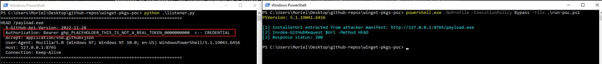

Package registries have become the most valuable real estate in the software supply chain. Compromise a single maintainer, and you reach everyone who trusts them. Compromise the gatekeepers, and you reach the entire ecosystem.

Windows Package Manager (winget) operates on a unique model: its catalog is a public GitHub repository (`microsoft/winget-pkgs`), and its gatekeepers are a small, official group of Microsoft moderators reviewing a constant stream of community pull requests. Every winget installation on every modern Windows machine ultimately trusts what these Microsoft employees merge.

What does it take to compromise one of them? The answer, it turns out, is a single pull request. I found this vulnerability and reported it to the Microsoft Security Response Center (MSRC). Here is how it works, and how Microsoft fixed it.

## When Automation Hands Over the Keys

No phishing. No malware. No interaction required from the Microsoft moderator.

The moderators' internal triage tool, a PowerShell script named `ManualValidationPipeline.ps1`, attaches the moderator's GitHub Personal Access Token (PAT) to every HTTP request it makes, with zero checks on the destination host.

One of the tool's automated code paths reads a URL provided in a submitted manifest and calls it. If an attacker opens a PR, points the `InstallerUrl` to a server they control, and waits, the trap is set. At twenty minutes past the hour, a Microsoft moderator's workstation will connect to the attacker's server and present an `Authorization: Bearer` header, casually handing over their official GitHub token.

To put this in perspective: it is like a courier stapling your house key to every parcel because most of them are destined for your own address. The one time a stranger writes the shipping label, your key is delivered directly to them.

## A Zero-Click Kill Chain

The only precondition for this attack is that at least one moderator has the triage tracker running in its designed mode of operation, which is a continuous background loop waiting for work.

From there, the kill chain is entirely mechanical:

- **The Bait:** The attacker opens a pull request against `microsoft/winget-pkgs` with an `InstallerUrl` pointing to their own server.
- **The Trigger:** Microsoft's automated Azure DevOps validation pipeline attempts to fetch the URL. The attacker's server intentionally returns an error, causing the pipeline to automatically apply a `URL-Validation-Error` label to the PR.
- **The Hook:** This specific label forces the moderator's automated loop to unconditionally run a `CheckInstaller` routine. The routine extracts the attacker's URL and sends a HEAD request to it.
- **The Catch:** The request is dispatched using an authenticated HTTP helper. The attacker simply checks their server logs and extracts the bearer token.

Adding insult to injury, the internal Microsoft tool then posts an automated comment on the PR on behalf of the moderator, recording the HTTP status code it received. The attacker gets public, documented confirmation that their exploit executed successfully.

*Figure 1: Proof of concept showing the automated Microsoft triage tool connecting to the rogue server.*

## The True Impact: From a Package Registry to Microsoft's Core

It is tempting to score this vulnerability simply as "unauthorized write access to winget-pkgs." That severely undersells the severity.

The compromised credential is a Classic Personal Access Token carrying the `workflow` scope. This is not a repository-scoped credential; it is a full identity credential. Whatever that Microsoft employee can do on GitHub, the token can do.

Armed with this token, an attacker can:

- **Push malicious manifests** directly to `winget-pkgs`, approve their own pull requests, and publish backdoored installers to every Windows client, all cryptographically signed off by a trusted Microsoft moderator.
- **Access and write to every other Microsoft repository** that the moderator has access to. You aren't just compromising a public package manager; you are inheriting the keys to Microsoft's internal ecosystem, committing code under a highly trusted, official Microsoft badge.
- **Modify GitHub Actions workflows** across those Microsoft repositories (thanks to the `workflow` scope), achieving Remote Code Execution (RCE) on CI/CD runners and exfiltrating the corporate secrets those pipelines hold.

The attacker does not need to breach the supply chain from the outside; they are operating strictly inside it. A poisoned commit to a side project reads as a routine maintainer fix. A backdoored `7zip` manifest ships as a standard update.

## The Fix: Implementing the Missing Allowlist (PR #456300)

The most frustrating aspect of this vulnerability was that the evidence of its preventability sat in the exact same directory. The triage tool has a C# port where the HTTP helper explicitly defaults the `Authorization` parameter to `false`, attaching the credential only when a caller explicitly opts in. The PowerShell version completely lacked this safeguard, aggressively broadcasting the token even to harmless endpoints like `githubstatus.com`.

I reported the issue to MSRC through its responsible disclosure program, and Microsoft has since patched it. The official remediation, implemented in [Pull Request #456300](https://github.com/microsoft/winget-pkgs/pull/456300), applies the exact logic that was missing. It safely scopes the authentication mechanism, ensuring that the bearer token is strictly attached only when the request host is an authorized GitHub endpoint (`api.github.com`, `github.com`, or `raw.githubusercontent.com`).

Beyond the code, the underlying credential model is fundamentally flawed. Relying on Classic PATs is a severe liability. Transitioning to a Fine-Grained Token strictly scoped to the `microsoft/winget-pkgs` repository confines the blast radius of a leak to a single public catalog, rather than compromising an entire human identity across Microsoft's organization.

## Takeaways for Security and Engineering Teams

- **Bind Credentials to Destinations, Not Functions:** Audit every internal tool that handles maintainer credentials. Ensure authentication headers are conditionally applied based on the target host, not unconditionally stapled by a wrapper function.
- **Treat All User Input as Hostile:** Assume any field submitted by a user, even a simple URL in a triage environment, will eventually be passed to an HTTP client. Validate hosts before credentials are attached.
- **Scope Down Automation:** Deprecate Classic PATs. The blast radius of a leaked token must be limited to one repository and the bare minimum permissions. A leaked token should never mean a leaked corporate identity.

The winget moderators are doing exactly what the open-source ecosystem asks of them: managing a flood of community submissions using automation to make the workload sustainable. But automation does not just remove the human who would have clicked the malicious link; it removes the human who would have noticed the anomaly. A package registry is only as secure as the laptops of its moderators, and a blind automated loop is the perfect target.
